# LARD

> **LARD** — *light as rust dust*

Desktop shell nativa per [niri](https://github.com/YaLTeR/niri), scritta **interamente in Rust**.
Niente QML, GTK, Qt, Node.js, Electron o QuickShell: solo `wayland-client` + `smithay-client-toolkit`,
`wgpu`, `cosmic-text`, `calloop` e `niri-ipc`.

```
barra a 3 isole ─ dock ─ launcher fuzzy ─ OSD ─ notifiche ─ control center
                         │
                 lockscreen PAM / greeter greetd
                         │
        wgpu (SDF + glyph atlas) · blur · animazioni a molle · TOML
```

## Installazione in un comando

```bash
./install.sh
```

Lo script compila in release e installa:

- `/usr/local/bin/lard`
- config di sistema `/etc/lard/config.toml` e, se manca, la config utente
- `/etc/pam.d/lard-greeter`
- asset greeter (`/etc/lard/greeter-sway.conf`, `greeter.kdl`)
- unit systemd utente e documentazione

Chiede `sudo` solo per i file di sistema, non per compilare. Se mancano le
dipendenze di build:

```bash
./install.sh --install-deps
```

Su un sistema senza Rust, `--install-deps` installa anche la toolchain stabile
via rustup, oltre ai pacchetti di build.

Aggiungere automaticamente anche il blocco in `~/.config/niri/config.kdl`
(con backup e controllo dei conflitti):

```bash
./install.sh --niri
```

Installazione senza root, solo per l'utente (`~/.local/bin`, `~/.config`):

```bash
./install.sh --user
```

Staging per packaging (non tocca il sistema):

```bash
./install.sh --root /tmp/stage --prefix /usr
```

Disinstallazione (la config utente viene preservata; usa `--purge` per rimuoverla):

```bash
./install.sh --uninstall
```

Il blocco eventualmente aggiunto con `--niri` non viene rimosso automaticamente
(per non toccare bind personalizzate); l'installer lo segnala e lascia il backup.

`make install` / `make uninstall` sono equivalenti. Il greeter con greetd
richiede comunque una scelta esplicita del compositore ospite: l'installer
installa gli asset ma **non modifica** `/etc/greetd/config.toml`, per evitare
lockout. La procedura è in [docs/greetd/config.toml](docs/greetd/config.toml).

## LARD come shell predefinita

LARD è pensato per sostituire DankMaterialShell: niri, greetd e il desktop
restano intatti, cambia solo la shell utente. Lo script incluso gestisce il
servizio e la config di niri:

```bash
lard-switch status        # stato dei servizi
lard-switch start|stop|restart
lard-switch prepare       # rigenera e valida ~/.config/niri/config-lard.kdl
lard-switch default-rust  # LARD come shell predefinita al login
```

La barra ha l'ingranaggio per il centro impostazioni; da tastiera:

```bash
lard ipc settings
```

I frammenti di configurazione di niri stanno in `~/.config/niri/lard` (layout,
alttab, output, cursor e le bind della shell) e la config alternativa in
`~/.config/niri/config-lard.kdl`: le bind di gestione finestre restano quelle
già presenti, mentre launcher, volume, luminosità, lock e power chiamano
`lard`.

Il greeter: con `greetd` la sessione predefinita diventa
`niri --config /etc/greetd/niri/config.kdl`, che ospita `lard greeter` come
client Wayland (stessa procedura di [docs/greetd/config.toml](docs/greetd/config.toml)).

## Anteprime

Renderizzate offscreen dallo stesso renderer wgpu (`cargo run -p lard-shell --example preview`):

| Barra a tre isole | Dock (opzionale, off di default) |
|---|---|
| 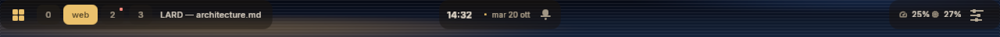 | 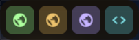 |

| Launcher | Control center |
|---|---|
| 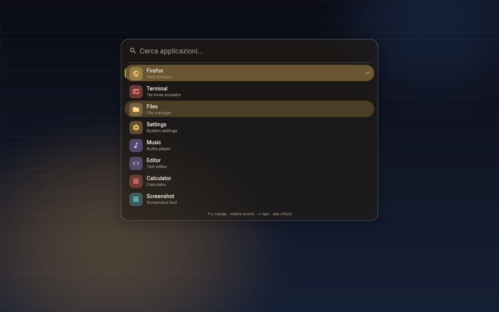 | 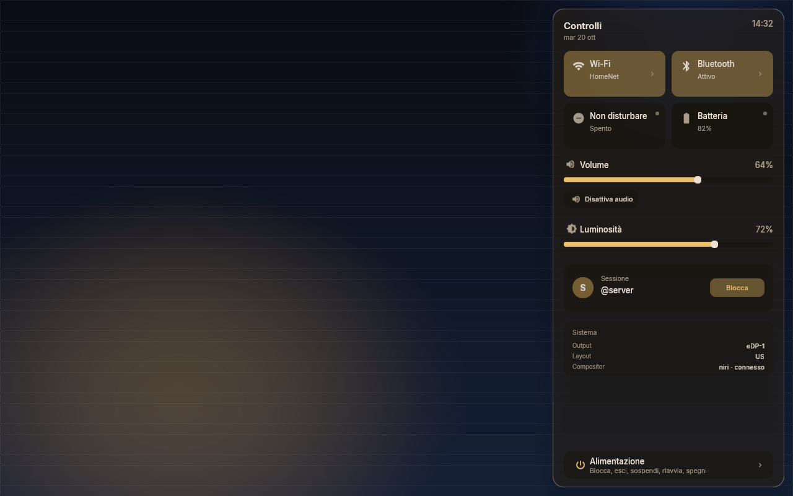 |

| Impostazioni shell | Centro di controllo raggruppato |
|---|---|
| 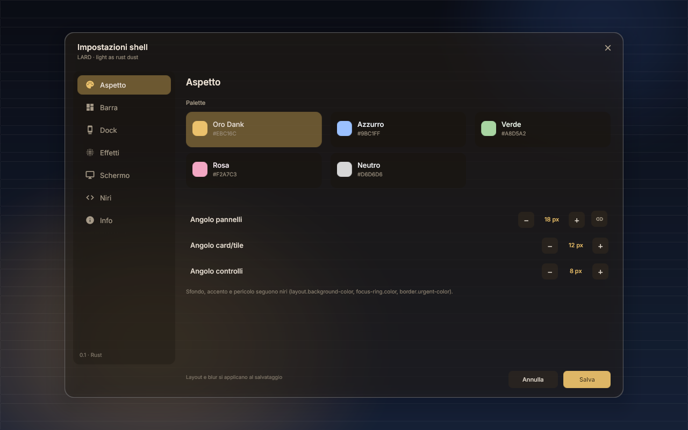 | 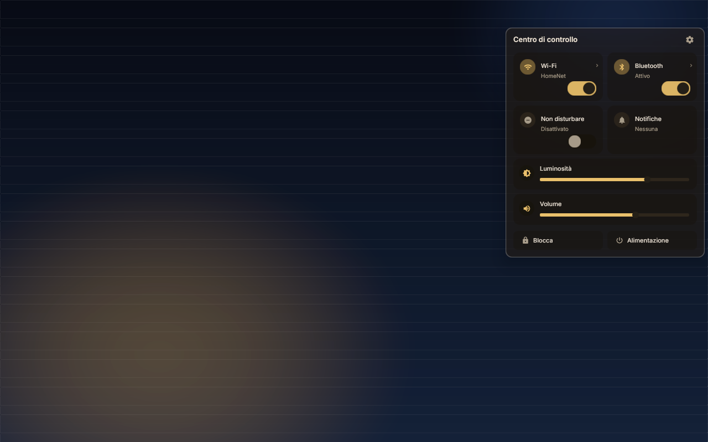 |

| Alimentazione dal centro di controllo | |
|---|---|
| 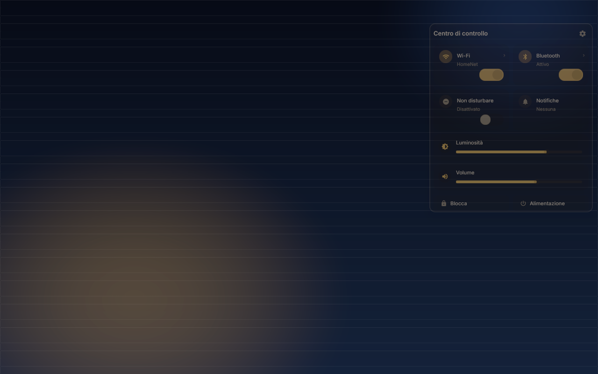 | |

| Lock screen | Greeter |
|---|---|
| 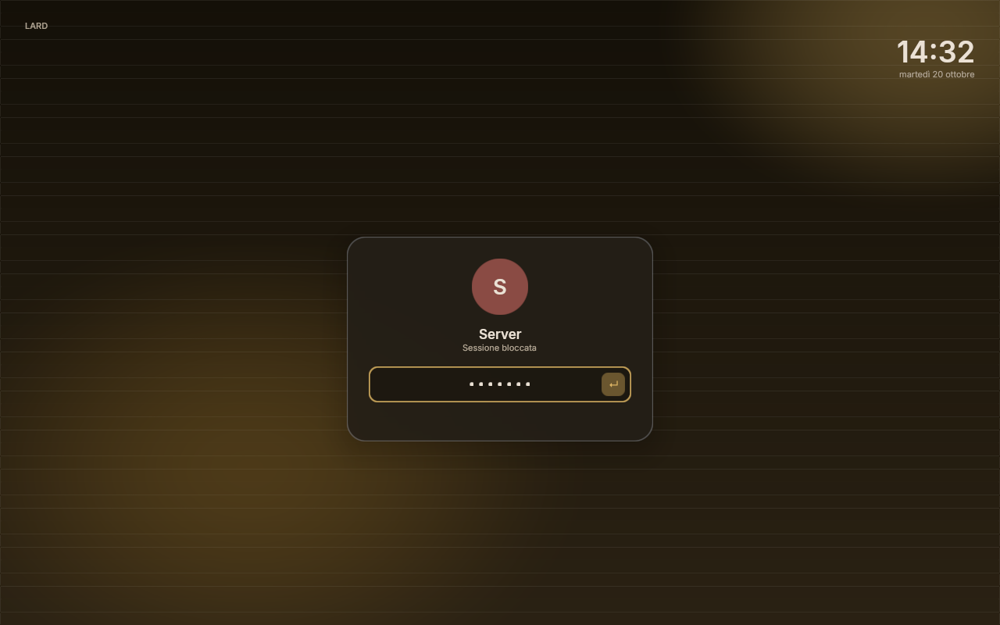 | 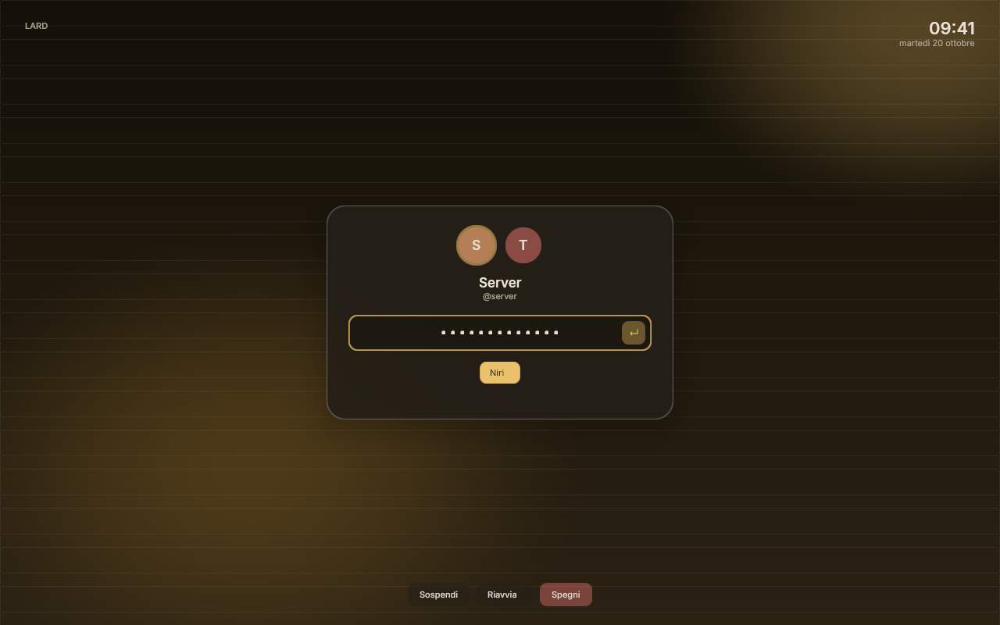 |

| OSD | Notifiche con azioni |
|---|---|
| 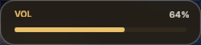 | 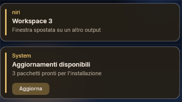 |

> **Stato: 0.1 validata su niri 26.04.** Barra/dock/launcher/control center,
> notifiche D-Bus, OSD, blur del compositore, lockscreen `ext-session-lock` con
> PAM e auto-unlock sono stati provati su niri reale (Intel HD 5500, Vulkan).
> Il greeter greetd è installato come asset ma **non** viene attivato
> automaticamente: la config del display manager resta quella scelta dal sistema.

---

## Stato reale

### Implementato

| Componente | Stato | Note |
|---|---|---|
| **Top bar** | ✅ | Tre isole flottanti in stile Dank: workspace + titolo, orologio/data e un unico pulsante **Controlli** che apre un centro di controllo in stile macOS. Ogni pannello che nasce da un'isola (launcher, controlli, orologio, notifiche) **morpha** fuori dall'isola di partenza: la forma **cresce ancorata all'angolo dell'isola** (non scivola), l'isola svanisce e il pannello **prende il posto dell'isola** nella fila della barra, crescendo verso il basso; il contenuto compare solo a forma finita. Il pannello raggruppa Wi‑Fi, Bluetooth, Non disturbare, notifiche, luminosità, volume, impostazioni e alimentazione; **CPU, RAM e batteria restano sull'isola destra** della barra (con la percentuale dimensionata su tre cifre, così il `%` non va a capo a 100%). Le tessere Wi‑Fi/Bluetooth hanno toggle e corpo cliccabile; il link di gestione espande lo stesso popover in-place (fino a 400×640) con lista, scansione, password e scrolling. Il sottomenu Alimentazione contiene blocca, esci, sospendi, riavvia, spegni. Nella barra c'è **solo un bottone** (il centro di controllo) a destra, con CPU e RAM: il launcher non è più in alto a sinistra (si apre con `Mod+D` o `lard ipc launcher`). Icone Material embedded (e **glifi disegnati a mano** per le isole: slider del centro di controllo, campanella), un `Bar` per output. Le isole sono vetro sospeso: `ext-background-effect-v1` ritaglia il blur del compositor sui tre pannelli arrotondati (la regione sfocata **segue la forma** che sta crescendo), e dal centro impostazioni si regolano altezza, **angolo**, opacità e blur delle isole. |
| **Dock** | ✅ | Isola inferiore centrata, app preferite + running, icone reali delle app (con glifo Material di riserva), indicatori di esecuzione. **Disattivato di default**; riattivabile da Impostazioni → Dock o in `[dock]`. |
| **Launcher** | ✅ | Overlay fullscreen con scrim e blur, fuzzy search `nucleo-matcher`, preferiti in cima, **icone reali delle app** (PNG/JPEG/WebP e SVG rasterizzate con `resvg`, risolte nei theme freedesktop e negli export Flatpak), tastiera + mouse, caret, animazione apertura/chiusura (l'uscita è l'inverso dell'ingresso). La lista **scorre** con la rotella quando le righe superano l'altezza della card (scrollbar sottile). Fa anche da **calcolatrice** (espressioni `+ - * / % ^`, `↵` copia il risultato) e da **file finder**: i percorsi (`~`, `/`, `./`, `../`) elencano la directory, le altre query cercano per nome nella home in background. |
| **OSD volume/luminosità** | ✅ | HUD dentro l'isola centrale della barra (prende il posto di orologio/data), crossfade verticale a molla, auto-hide con timer esatto (niente polling). |
| **Luminosità** | ✅ | Slider nel control center, OSD e IPC; sysfs + fallback `brightnessctl`. |
| **Notifiche** | ✅ | Server D-Bus `org.freedesktop.Notifications` reale con `zbus`, timeout, dismiss, azioni (`ActionInvoked`), sostituzione per `replaces_id`, `NotificationClosed`. La campanella sta nell'isola centrale (a destra della data, con badge); la notifica **prende il posto dell'orologio** e allarga l'isola su una superficie overlay dedicata, che passa **sopra le finestre** senza ridimensionarle, con decay di ~1,4 s. Il testo è dimensionato con le **advance reali del font**, quindi le notifiche lunghe non vengono tagliate con l'ellipsis. La campanella apre il **pannello delle notifiche sotto l'isola centrale**, con l'elenco e le azioni. |
| **Control center** | ✅ | Due accessi allo stesso motore: il popover raggruppato del pulsante Controlli (griglia macOS con tessere, slider, stato sistema e sottomenu Alimentazione) e il pannello laterale sfocato, ancora disponibile via IPC. Pagine Wi‑Fi e Bluetooth con scansione (manuale e **automatica ogni 20 s**, senza ridisegni se la lista non cambia), selezione rete/dispositivo, **password Wi‑Fi** e **credenziali 802.1X** (utente + password, PEAP/MSCHAPv2 con fallback TTLS/PAP) per le reti **WPA‑Enterprise**, connessione, pagina Alimentazione (blocca, esci, sospendi, riavvia, spegni). Gli slider di volume e luminosità si **trascinano** (pressione + movimento, non solo click), aggiornano la UI in modo ottimistico e coalesciano le scritture per non far laggare il cursore. Liste lunghe scorrevoli con rotella e frecce. I link di gestione espandono lo stesso popover in-place, senza aprire il pannello laterale. |
| **Centro impostazioni** | ✅ | Overlay sfocato con palette Dank/Azzurro/Verde/Rosa/Neutro, altezza, **angolo** e **opacità delle isole**, **opacità del dock**, toggle dei moduli mostrati nel centro di controllo, e una sezione Effetti con **blur pannelli**, **blur isole**, **opacità pannelli** e **livello vetro**, più riduzione movimento, posizione notifiche e diagnostica. Gli angoli hanno tre livelli (controlli, card/tile, pannelli) e un tasto **catena** che li blocca tutti sul valore master. Una tab **Niri** modifica la configurazione di niri da GUI (spazi fra le finestre, bordi, focus, colonna al centro, schede, risoluzione e scala): i valori vengono scritti nei file KDL con backup `.bak` e niri viene ricaricato. Salva in TOML con backup e ricrea le superfici. |
| **Lockscreen** | ✅ | `ext-session-lock-v1` + PAM nativo, `ack_configure` corretto prima del primo buffer, watchdog fail-open, unlock con password. Testato su niri reale. |
| **Greeter** | ✅ | UI avatar/utente/password/sessione/power; backend **greetd** per il login. Modalità `--preview` con PAM per provare la UI senza avviare una sessione. |
| **Renderer** | ✅ | Un device wgpu condiviso, pipeline instanziate SDF (rect, bordi, ombre/glow) + atlas R8 per i glifi, text cache, arena di stringhe, `ext-background-effect-v1`. |
| **Animazioni** | ✅ | Solutore analitico dello smorzatore armonico: traiettoria identica a 60/120/144 Hz, nessun accumulatore. |
| **Config** | ✅ | `config.toml` completo con temi, font, raggi (controlli / card-tile / pannelli, con la **catena** per bloccarli tutti uguali), ombre, blur, spaziature e spring; errori su campi sconosciuti. Il wallpaper scelto nel carosello viene ricordato qui e riapplicato all'avvio. Con `follow_niri` la shell **non duplica** i valori che spettano a niri ma li legge dalla sua configurazione (vedi sotto). |
| **Controllo runtime** | ✅ | Socket `$XDG_RUNTIME_DIR/lard.sock` + CLI `lard ipc …` (anche `lard ipc controls` per il pannello raggruppato e `lard ipc settings-<tab>`). |

### Valori condivisi con niri

La shell e niri non devono tenere due copie degli stessi colori: con
`theme.follow_niri = true` (default) LARD legge dalla configurazione di niri e
segue questi valori, aggiornandoli a ogni reload:

| valore di LARD | chiave di niri |
|---|---|
| `theme.background` (solo il colore, la trasparenza resta di LARD) | `layout.background-color` |
| `theme.accent` | `layout.focus-ring.color` |
| `theme.danger` | `layout.border.urgent-color` |

`background-color "transparent"` viene ignorato (niri lascia vedere il
wallpaper). La palette delle impostazioni non tocca più questi tre valori: per
cambiarli si modifica niri, e LARD si riallinea subito (il file watcher ricarica
la configurazione al volo).

### Parziale / da completare

| Area | Cosa manca |
|---|---|
| **System tray (SNI)** | Non ci sono icone tray: solo gli indicatori di stato integrati. Il protocollo StatusNotifierItem (DBus + menu + immagini) è il prossimo modulo. |
| **Servizi nativi** | Rete (NetworkManager) e Bluetooth (BlueZ) sono client zbus event-driven, con fallback a `nmcli`/`bluetoothctl`. Audio usa ancora `pactl subscribe` + `wpctl`. |
| **Blur** | Usa `ext-background-effect-v1` su pannelli e isole: se niri non lo espone, la UI resta vetrosa/alpha. La regione è ritagliata sui pannelli (isole della barra, dock, overlay). Non c'è un blur del backdrop fatto in casa (servirebbe screencopy: costoso). |
| **Multi-monitor** | Barre e lock surface per output ✅; ogni lock surface ha la propria hit-map. Il greeter usa ancora un solo output. |
| **Scala frazionaria** | Scala intera (`wl_output.scale`). 1.25/1.5x viene scalato dal compositor. |
| **Icone applicazioni / emoji** | Le icone delle app sono quelle reali del tema icone: PNG/JPEG/WebP via `image`, SVG rasterizzate con `resvg` (risolte in `hicolor`, nei theme Adwaita e negli export Flatpak). Non sono supportati XPM/ICO e le emoji a colori vengono rese come maschere monocromatiche nell'atlas R8 (nomi Wi‑Fi e titoli restano leggibili). |
| **Hot reload config** | ✅: watcher inotify su `config.toml` (e `lard ipc reload` manuale). Ricarica tema/layout/font e ricrea le superfici; i parametri dei singoli spring restano quelli dell'avvio. |
| **Salvaschermo** | Integrato nella shell e interamente procedurale: un fondale scuro piatto, quattro scene — Liquido, Mercurio, Aurora, Gas — valutate nel fragment shader, più uno strato di polvere luminosa sopra ognuna, senza immagini, sprite o particelle. Ingresso e uscita sono un burn-in (prima le luci in sovrimpressione, poi i corpi, per ultima la stanza) e le frecce ← → cambiano scenario con un crossfade, senza slideshow automatici. In più le **scene scritte dall'utente**: script Rhai in `~/.config/lard/scenes/*.rhai` che disegnano forme (dischi, anelli, rettangoli) sopra la stanza procedurale, con due esempi già pronti. Tutto regolabile dalle impostazioni: inattività, scenario o casuale, scene da script, ingresso, vetro, velocità, intensità, orologio. Anche la schermata di blocco mostra lo sfondo del desktop (scurito, regolabile da Impostazioni → Blocco). L'idle arriva da `ext-idle-notify-v1` (nessun `swayidle`), la surface è un layer overlay per output e qualsiasi altro tasto o movimento la chiude. Non blocca la sessione: per quello c'è `lard lock`. |

---

## Architettura

Workspace Cargo con responsabilità separate (nessuna dipendenza circolare):

```
lard/
├── Cargo.toml
├── install.sh       build + install/uninstall in un comando
├── Makefile
├── config/config.toml
├── docs/
├── assets/fonts/    Inter + JetBrains Mono + Material Icons embedded
└── crates/
    ├── lard-core         config, tema, colori sRGB/lineare, geometria, spring, .desktop
    ├── lard-render       wgpu device/surface, SDF, atlas testo, cache layout, shader WGSL
    ├── lard-services     niri IPC, audio, batteria, rete, bluetooth, notifiche D-Bus, power
    ├── lard-shell        viste: bar, launcher, OSD, toast, control center
    ├── lard-greeter      PAM FFI, greetd IPC, utenti/sessioni, UI lockscreen/greeter
    ├── lard-wayland      client Wayland, layer-shell/session-lock, input, frame loop, IPC
    └── lard              binario + CLI
```

Dipendenze:

```
lard → lard-wayland → { lard-shell, lard-greeter, lard-render, lard-services, lard-core }
lard-shell  → { lard-render, lard-services, lard-core }
lard-greeter→ { lard-render, lard-services, lard-core }
lard-render → lard-core
lard-services → lard-core
```

Diagramma e decisioni nel dettaglio: [`docs/ARCHITECTURE.md`](docs/ARCHITECTURE.md).

### Superfici Wayland

| Ruolo | Protocollo | Layer / anchor | Tastiera |
|---|---|---|---|
| Bar | `zwlr_layer_shell_v1` | Top, TOP+LEFT+RIGHT | None |
| Dock | `zwlr_layer_shell_v1` | Top, BOTTOM | None |
| Launcher | layer shell | Overlay fullscreen | Exclusive |
| Control center | layer shell | Overlay fullscreen | Exclusive |
| OSD | integrato nella barra | isola centrale, nessuna surface dedicata | — |
| Toast | layer shell | Overlay, TOP+RIGHT | None |
| Greeter | layer shell | Overlay fullscreen | Exclusive |
| Lockscreen | `ext-session-lock-v1` | lock surface per output | gestita dal compositor |

Ogni superficie ha un `SurfaceEntry` con `RenderSurface` dichiarato **prima** di
`LayerSurface`/`SessionLockSurface`/`wl_surface`: l'ordine di drop garantisce che
la swapchain wgpu venga distrutta prima dell'oggetto Wayland.

---

## Build manuale (opzionale)

L'installer fa tutto; questi passi servono solo per sviluppo o packaging.
Requisiti: Rust stable (edition 2024, `rust-version = 1.89`), `pkg-config`,
libwayland, libpam, fontconfig, Vulkan o OpenGL.

```bash
# Debian/Ubuntu
sudo apt install build-essential pkg-config libwayland-dev libpam0g-dev \
                 libfontconfig1-dev libxkbcommon-dev libvulkan-dev

# Arch
sudo pacman -S base-devel pkgconf wayland pam fontconfig libxkbcommon vulkan-icd-loader

cargo build --release --locked
cargo run -p lard-render --example headless_smoke   # verifica GPU/WGSL/font offscreen
cargo run -p lard-shell --example preview           # screenshot in ./preview/
```

Il percorso config è `$LARD_CONFIG` se impostata, altrimenti
`$XDG_CONFIG_HOME/lard/config.toml` (o `~/.config/...`), poi
`/etc/lard/config.toml` (installato dall'installer, utile per il greeter),
poi i default incorporati.

---

## Avvio

Dentro una sessione niri:

```bash
lard                 # shell (barra + launcher + OSD + notifiche + CC)
lard lock            # lockscreen
lard greeter --preview  # prova UI greeter con PAM, nessuna sessione avviata
```

Bind consigliate in `~/.config/niri/config.kdl` ([esempio](docs/niri/config.kdl)):

```kdl
spawn-at-startup "lard"

binds {
    Mod+D       { spawn "lard" "ipc" "launcher"; }
    Mod+Shift+E { spawn "lard" "ipc" "control-center"; }
    Mod+Escape  { spawn "lard" "lock"; }
    Mod+Shift+Q { spawn "lard" "ipc" "quit"; }
}
```

IPC disponibile:

```
launcher, control-center, wifi, bluetooth, power-menu, settings, wallpapers,
volume-up, volume-down, toggle-mute, brightness-up, brightness-down, reload,
lock, quit
```

---

## Lockscreen e PAM

Il lock screen è un **processo separato** e non privilegiato. `ext-session-lock-v1`
viene concesso dal compositore; la superficie resta opaca finché la password non è
verificata, poi la card fa fade-out e viene chiamato `unlock()`.

Installazione del servizio PAM:

```bash
sudo install -Dm644 docs/pam.d/lard-greeter /etc/pam.d/lard-greeter
```

Il file usa **solo** `auth required pam_unix.so`. Non chiamiamo `pam_acct_mgmt`:
un lockscreen gira come l'utente e su un `/etc/shadow` standard non può leggere la
scadenza della password; `pam_unix(account)` fallirebbe e il lock resterebbe
bloccato. La policy di account va applicata al login (greetd). Se vuoi
`pam_faillock`, aggiungilo consapevolmente al servizio e testa lo sblocco.

Sicurezza implementata:

- PAM via FFI minimale (`pam_start`/`pam_authenticate`/`pam_end`), nessun bindgen a runtime.
- Conversazione PAM con allocazione libc (PAM possiede e libera le risposte).
- Password in `Zeroizing<String>`, copia C azzerata con scritture volatile.
- Validazione di service name (`[A-Za-z0-9_-]`, niente path traversal) e username.
- Errori generici: non rivelano se l'utente esiste.
- Rate limit UI con backoff dopo tentativi falliti.
- Nessun log della password.

**Prerequisito compositore**: alcuni compositori limitano `ext-session-lock-v1` a
client privilegiati. Se `lard lock` termina con "ext-session-lock
unavailable", controlla la policy di niri/`ext-session-lock`.

---

## Greeter / greetd

Un client Wayland **non può essere un greeter da solo**: serve un compositore che
lo ospiti. La scelta corretta è far gestire a greetd il confine di privilegio
(PAM, sessione, logind) e tenere il greeter non privilegiato.

```
greetd → sway kiosk (layer-shell) → lard greeter → greetd.start_session()
                                                            → niri-session (utente)
```

Config greetd: [`docs/greetd/config.toml`](docs/greetd/config.toml). Serve un
utente non privilegiato dedicato (l'installer non lo crea):

```bash
sudo useradd --system --create-home --shell /usr/sbin/nologin greeter
```

```toml
[default_session]
command = "sway --config /etc/lard/greeter-sway.conf"
user = "greeter"
```

Sway è solo il compositore ospite e termina quando il greeter esce
([`docs/greetd/sway-greeter.conf`](docs/greetd/sway-greeter.conf)). **Cage non va
bene**: non implementa `wlr-layer-shell`.

Il greeter parla il protocollo di greetd su `GREETD_SOCK` (framing
`len: u32` native-endian + JSON, **non** JSON per riga); se la variabile
non è presente si rifiuta di partire (a meno di `--preview`). È un client
layer-shell: serve un compositore ospite con `zwlr_layer_shell_v1` (sway, niri;
non cage). `--preview` usa PAM in-process ma **non avvia** una sessione: serve
solo a provare la UI.

Alternativa: usare niri stesso come compositore ospite con
[`docs/greeter-niri.kdl`](docs/greeter-niri.kdl). È più pesante di sway ma evita
un secondo tipo di compositore.

---

## Prestazioni

Obiettivi di design, non slogan:

- **Idle = zero frame callbacks.** Nessun timer a 16 ms. La shell si sveglia per
  eventi Wayland, IPC niri, notifiche D-Bus, o timer esatti (orologio al minuto,
  scadenze OSD/toast).
- **VSync reale.** `PresentMode::Fifo` + `wl_surface.frame` prima del commit;
  quando un'animazione è attiva si disegna al refresh, quando finisce si smette.
- **2 draw call per superficie**: un draw instanziato per tutte le forme SDF, uno
  per tutti i glifi. Non un draw per widget.
- **Testo**: shaping con cosmic-text solo al cambio di stringa; i frame successivi
  fanno un hash FNV + confronto. L'atlas R8 carica ogni glifo una volta.
- **Render path senza allocazioni GPU**: buffer istanziati riusati, una sola arena
  di stringhe per `Scene`, atlas caricato una volta. Le viste possono formattare
  poche stringhe brevi quando lo stato cambia o durante un'animazione; non c'è
  shaping né allocazione di buffer/target per-frame. I `RenderSurface` vengono
  creati solo quando un overlay è visibile e distrutti quando l'animazione è
  finita.
- **Servizi fuori dal thread UI**: niri, audio, batteria, rete, bluetooth e D-Bus
  notifiche girano su thread dedicati e comunicano con `calloop::channel`.
- **RAM**: un device wgpu condiviso, un atlas 2048² (4 MB), font embedded (2.7 MB),
  swapchain solo per le superfici visibili. Nessun GC, nessun runtime JS.

Per diagnosticare: `RUST_LOG=lard_wayland=trace` stampa i frame presentati con
numero di istanze e draw call.

---

## Limiti noti (importanti)

1. **Non testato su niri reale in questo ambiente.** Compilazione, test unitari,
   parsing del config e link di PAM/wgpu sono verificati; la resa visiva e
   l'interazione con un compositore vanno validate sul campo.
2. **Blur del backdrop**: solo via `ext-background-effect-v1`. La regione di
   blur viene ritagliata sui pannelli (isole della barra, dock, overlay), mai
   su tutta la superficie. Se niri non lo espone, non c'è blur del desktop
   dietro le isole; il fallback è alpha/vetro.
3. **Multi-output**: lockscreen e greeter coprono tutti gli output con hit-map
   per-superficie; il greeter dà focus esclusivo al primo output e OnDemand agli altri.
4. **Tray**: nessuna icona SNI.
5. **Servizi**: rete e Bluetooth sono nativi via zbus (event-driven); l'audio usa
   ancora `pactl`/`wpctl` e non è un client PipeWire nativo. Batteria/luminosità
   leggono sysfs con poll lenti.
6. **Luminosità**: lo slider scrive su `/sys/class/backlight`; se il tuo utente non
   ha permessi, installa `brightnessctl` o aggiungilo al gruppo `video`/regola udev.
7. **Scala frazionaria**: gestita come scala intera; il compositor può risultare
   leggermente morbido a 1.25/1.5x.
8. **Emoji/immagini**: non supportati nell'atlas; avatar a iniziali.
9. **Hot reload**: automatico via inotify; i parametri delle molle dei widget restano quelli dell'avvio.
10. **`pam_acct_mgmt`**: volutamente non chiamato nel lockscreen (vedi sopra).
11. **Greeter `--preview`**: non avvia la sessione; non usarlo come login reale.
    Girando come utente, PAM può autenticare solo l'utente corrente (il login di
    altri utenti richiede greetd/root). Supporta password singola, non prompt
    interattivi multipli (OTP, domande di sicurezza).

---

## Roadmap

1. Validazione e profiling su niri 26.x (Vulkan + GL), correzione DPI/scale.
2. Client nativi: PipeWire, UPower/logind (batteria e luminosità event-driven).
3. StatusNotifierItem + DBusMenu + icone PNG/SVG (atlas RGBA).
4. Atlas RGBA per emoji e icone; font fallback CJK già via fontconfig.
5. Greeter multi-output con output picker.
6. Night light/gamma e brightness via logind (`SetBrightness`).
7. Spring aggiornabili senza riavvio e reload selettivo per singolo modulo.
8. Greeter: compositore ospite integrato opzionale (Smithay) per vero standalone,
   mantenendo greetd come backend privilegiato.
9. Test di integrazione Wayland headless (headless compositor + surface smoke test).
10. Packaging nativo (Arch/AUR, Debian, Nix) oltre a `install.sh` e preset temi.

---

## Licenza

GPL-3.0-or-later (vedi [`LICENSE`](LICENSE)).
Font: Inter (OFL-1.1) e JetBrains Mono (OFL-1.1), licenze in `assets/fonts/`.
